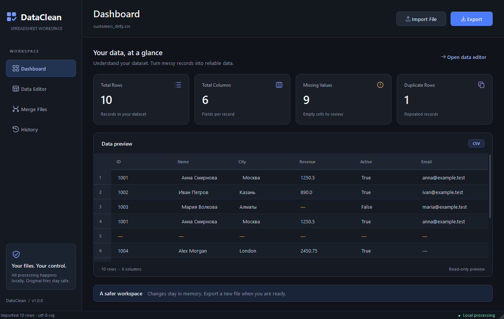

# DataClean


**A focused desktop workspace for cleaner spreadsheets.**

DataClean is a local Windows application for inspecting, cleaning, combining and exporting CSV and Excel data. A modern graphite interface keeps the important numbers visible, while reversible operations and protected source files make everyday cleanup predictable.



## Features

- **Dashboard:** live row, column, missing-cell and duplicate-row counts with a virtual table preview.
- **CSV import:** UTF-8, UTF-8 BOM, UTF-16 and common legacy encodings; automatic detection plus an explicit manual encoding choice. Choose **Text — preserve values** (the UI default) to retain leading zeros, literal `NA`/`NULL`, long identifiers and decimal digits, or opt into automatic type detection. Comma, semicolon, tab and pipe separators are detected automatically.
- **Excel import:** `.xlsx` workbooks with a worksheet picker for multi-sheet files.
- **Data Editor:** remove duplicate rows, remove completely empty rows, trim text boundaries and fill missing values with text or a number.
- **Undo and reset:** restore previous working states or the original imported dataset. Reset itself can be undone.
- **Merge Files:** combine multiple CSV/XLSX datasets by rows, align matching columns by name, inspect the result, export it or open it in the editor. Column mismatches explain exactly what is missing or extra.
- **Session History:** operation time, affected row count, duration, outcome and result details, including failures.
- **Safe export:** UTF-8 BOM CSV or XLSX, overwrite confirmation, source-path protection and temporary-file replacement to avoid incomplete output files. XLSX values and headers exceeding 32,767 characters are rejected before writing. CSV offers formula checks or an explicitly confirmed unprotected export; values are never automatically escaped or truncated.
- **Responsive workflow:** imports, workbook inspection, transformations, statistics and exports run through a worker pool. Widgets and Qt models are updated only on the GUI thread.
- **Native desktop UX:** consistent dark styling, local SVG icons, resizable window, tooltips, loading indicator, empty states and keyboard shortcuts.

No accounts, paid APIs, web servers or cloud processing are used. The app does not send documents anywhere.

## Technology

| Layer | Technology |
| --- | --- |
| Runtime | Python 3.11+; verified locally on Python 3.13 |
| Desktop UI | PySide6 / Qt Widgets, QSS, local SVG icons |
| Data preview | `QAbstractTableModel` and `QTableView` |
| Processing | pandas |
| Excel I/O | openpyxl |
| Encoding detection | charset-normalizer |
| Background tasks | `QRunnable`, `QThreadPool`, queued Qt signals |
| Verification | pytest, pytest-qt, Ruff |

The dependency is **PySide6-Essentials**, the official PySide6 distribution containing the Qt modules this app uses. Unused Qt Addons and WebEngine packages are not needed.

## Windows portable release 1.0.0

The locally prepared Windows x64 package is **`release/DataClean-v1.0.0-win64.zip`**. It contains `DataClean.exe`, an embedded Python runtime, required libraries, application assets and license notices. No Python installation, account, administrator access or system installation is required.

1. Obtain the ZIP from the project owner, or from the [planned GitHub Releases page](https://github.com/StepanPozd/DataClean/releases) once it is published. Preparing this repository does **not** publish a release.
2. Extract the **entire** `DataClean/` folder to a writable location.
3. Open **`DataClean.exe`**. Keep `_internal/` beside it; do not copy the EXE alone.
4. Import your data, clean the working copy and export to a new filename.

Target: **Windows 10/11 x64** with the native Windows ICU API. The executable is **not digitally signed**; Windows may show an unknown-publisher or SmartScreen warning. DataClean does not disable or require disabling security software. SHA-256 checksums are supplied alongside the ZIP and in `PACKAGING_REPORT.md`; `MANIFEST.sha256` inside the application folder covers its individual files.

This is a portable **onedir** application, not an installer or a self-extracting onefile executable. It adds no startup entry or updater. Read `READ_ME_FIRST.txt`, `THIRD_PARTY_NOTICES.md` and `LICENSES/` in the extracted folder. See [RELEASE_NOTES.md](RELEASE_NOTES.md) for capabilities and [PACKAGING_REPORT.md](PACKAGING_REPORT.md) for the actual build/testing evidence and limits.

## Install from source on Windows

Open PowerShell in the project directory:

```powershell
cd D:\DataClean
py -3 -m venv .venv
.\.venv\Scripts\python.exe -m pip install -r requirements.txt
```

Using the virtual environment's Python directly avoids PowerShell activation-policy issues. On a new machine, install Python 3.11 or later first. Installation requires internet access; running the installed application does not.

For the exact dependency versions used during local validation:

```powershell
.\.venv\Scripts\python.exe -m pip install -r requirements-lock.txt
```

## Run

```powershell
.\.venv\Scripts\python.exe main.py
```

Or double-click **`start.bat`** to launch without a console. The launcher expects the local `.venv` to be installed already.

The portable EXE has its own launcher and runtime; `start.bat` is for source checkouts only.

Optionally open a document on startup:

```powershell
.\.venv\Scripts\python.exe main.py "D:\DataClean\examples\customers_workbook.xlsx"
```

| Shortcut | Action |
| --- | --- |
| `Ctrl+O` | Import file |
| `Ctrl+E` | Export the active dataset (merged result on the Merge Files page) |
| `Ctrl+Z` | Undo the last editor transformation |
| `Ctrl+1` ... `Ctrl+4` | Dashboard, Data Editor, Merge Files, History |

## Try a cleanup

1. Click **Import File** and choose `examples/customers_dirty.csv`. Keep automatic encoding detection. For this synthetic walkthrough, choose **Automatic type detection** to reproduce the counts below. For real identifiers and precision-sensitive values, keep the recommended **Text** mode instead.
2. Dashboard starts with **10 rows, 6 columns, 9 missing values and 1 duplicate row**.
3. In **Data Editor**, use **Remove Duplicates**, **Remove Empty Rows** and **Trim Whitespace**. The working dataset now has **7 rows**.
4. Use **Fill Missing Values** with text such as `Unknown` or a number such as `0`.
5. Try **Undo Last Action** or **Reset to Original** to check the results.
6. Export under a **new filename**, for example `customers_cleaned.xlsx`.

`customers_workbook.xlsx` offers the same records on the `Customers` sheet and a second sheet named `New customers`.

## Try a merge

1. Open **Merge Files** and select **Add files**.
2. Add `customers_dirty.csv` and `customers_more.csv` from `examples`.
3. Click **Merge files**. The preview contains **13 rows** and preserves duplicate records until you explicitly clean them.
4. Choose **Export result** or **Use in data editor**.
5. To inspect an intentional validation failure, add `incompatible_columns.csv` and try merging.

`customers_reordered.xlsx` demonstrates that the same column names may arrive in a different order. `legacy_cyrillic.csv` demonstrates Windows-1251 text.

All bundled examples are synthetic; no real user documents are part of this project.

## Preserve identifiers and choose CSV behavior

The CSV import dialog separates **encoding** from **value interpretation**. Both choices also apply to merge inputs, and an encoding retry retains the chosen interpretation.

| Import mode | Behavior |
| --- | --- |
| **Text — preserve values (recommended)** | UI default. All fields remain strings: `00123`, `00045`, `NA`, `NULL`, long digit sequences, exponent notation and precise decimal text retain their spelling. No numeric or null-token inference runs. Empty fields and blank records remain empty strings. |
| **Automatic type detection** | Explicit opt-in in the dialog. pandas infers types and missing values. Leading zeros can disappear, numbers can lose precision, and standard tokens such as `NA`/`NULL` become missing. |

In Text mode, **Missing Values** does not count empty strings and **Fill Missing Values** does not replace them. **Remove Empty Rows** still recognizes rows containing only empty strings or whitespace. Choose Auto only when its conversion semantics are appropriate for your data.

For Python callers, `read_file(path, csv_mode="text")` enables preservation. The core API retains its historical `csv_mode="auto"` default for compatibility; do not rely on that default for identifiers. `MainWindow.load_path(..., encoding="utf-8", csv_mode="text")` supports an explicit mode when bypassing the dialog.

### CSV export and spreadsheet formulas

The save dialog offers two CSV choices:

| Export choice | Behavior |
| --- | --- |
| **CSV formula-checked** | Default CSV policy. Rejects formula-like text in data or headers before writing. Includes `=`, `+`, `-`, `@`, leading tabs/CR/LF, whitespace-prefixed variants and full-width signs. Recommends XLSX or an explicitly selected raw export. |
| **CSV exact values (unprotected)** | Writes the existing field values without formula checks or added prefixes. The UI requires confirmation that this file is for controlled data exchange and must not be opened directly in a spreadsheet. |

Neither mode adds apostrophes or tabs, strips whitespace, replaces formulas or changes the working DataFrame. CSV quoting only encodes separators, quotes and line breaks. Checks are conservative: the string `-12` is flagged, while an actual negative numeric value is allowed. Checked CSV is a formula policy, not a guarantee against every spreadsheet's interpretation or later save/reopen behavior.

**CSV has no cell types.** Both export choices explain that opening CSV directly in Excel can change leading zeros, long identifiers, dates and numbers. To preserve text types in a spreadsheet, export **XLSX**: string values are stored as text, including formula-like strings. Alternatively, import CSV into the spreadsheet with every relevant column explicitly set to Text. CSV cannot encode a distinction between an empty string and a null value; its guarantee concerns the current serialized field values, not all DataFrame metadata or the original source bytes.

The core export API defaults to `csv_mode="spreadsheet"` (formula checks). `export_file(frame, path, csv_mode="raw")` is an explicit unprotected choice for callers who control the consumer. Warnings and choices are presented in the GUI; the core API does not open dialogs.

### XLSX size validation

All exported headers and data values are checked before a temporary file is created. Text longer than **32,767 characters** blocks the entire XLSX export with its row/column location and a suggestion to use CSV. Values exactly at the limit are accepted. No automatic shortening occurs, and an existing destination remains untouched after a validation error. CSV can store longer text; choose its formula policy separately if the value looks like a formula.

## Data and safety behavior

- Import requires a header row with unique, non-empty column names. `.xls`, `.xlsm` and password-protected workbooks are not supported.
- The first occurrence of an identical row is retained when removing duplicates. The duplicate statistic counts repeated rows beyond their first occurrence.
- A missing value is a pandas null (`NaN`, `None`, `NaT`, etc.). CSV Auto mode recognizes standard pandas null tokens such as `NA`/`NULL`, and empty fields become missing. CSV Text mode preserves those tokens and empty fields as strings. Whitespace-only strings are handled by **Remove Empty Rows**, rather than silently converted at import.
- **Trim Whitespace** removes leading and trailing whitespace; internal spaces are preserved. **Fill Missing Values** leaves existing empty strings and whitespace untouched.
- A text replacement in a numeric column can produce a mixed-type column. CSV Auto mode and the existing XLSX importer use pandas type inference. CSV Text mode preserves the original field spelling; it cannot recover precision already lost during an earlier numeric conversion. This is a data-table tool, not a lossless Excel workbook editor.
- The preview is read-only. Cleaning tools apply to the whole working dataset, independent of table selection.
- Undo holds up to **10 actions**, pruning older snapshots when their estimated total size exceeds **256 MiB**. At least the immediately preceding state is retained. Original and current data are held separately from that history. This is a soft undo-memory limit, not a cap on application memory.
- Frames are immutable by internal convention: transformations return new DataFrames and snapshots are swapped only when a worker succeeds. A failed action does not replace the current dataset. A new import starts a new undo chain.
- Successfully imported source paths stay protected for the entire session, including merge inputs and previously opened files. Export also checks existing hard-link aliases. Source files cannot be overwritten even after an overwrite confirmation.
- Existing output files require confirmation. Export writes to a temporary file in the destination directory before committing it; failed serialization leaves the existing destination intact.
- CSV output is UTF-8 with BOM for Cyrillic-friendly Excel use, with the explicit formula policy described above. XLSX export writes one `Data` sheet, freezes the header and adds an auto-filter. Formula-like text is written literally in XLSX. Numeric cells remain subject to Excel's precision limits; keep precision-sensitive fields as text from import onward.
- Excel formatting, macros, charts, formulas and other worksheets are not copied to exports. Imports read formula cached values; a formula without a cached value may appear as missing. Excel's row/column limits are checked before export.
- Automatic encoding and delimiter detection are heuristic. If text looks incorrect, reimport with an explicit encoding. For malformed CSV, repair the header/separator structure before importing.
- History and working changes exist only for the current session. Export before closing. Closing or replacing an edited dataset asks for confirmation.

## Project structure

```text
DataClean/
├── main.py                     # QApplication and Windows entry point
├── start.bat                   # Local desktop launcher
├── requirements.txt            # Runtime dependency ranges
├── requirements-dev.txt        # Test and lint tools
├── requirements-lock.txt       # Validated local dependency versions
├── pyproject.toml              # pytest and Ruff configuration
├── DataClean.spec              # Windowed onedir packaging and dependency selection
├── build_release.ps1           # Local checks, icon rendering, EXE and ZIP build
├── PACKAGING_REPORT.md         # Actual release checks, hashes and limitations
├── app/
│   ├── resources.py            # Source/frozen asset paths
│   ├── core/
│   │   ├── data_processor.py   # Pure, independently testable transformations
│   │   ├── data_manager.py     # Snapshot state, undo, reset and saved-state tracking
│   │   ├── file_handler.py     # File I/O, encodings, validation, safe exports
│   │   └── history_manager.py  # Session audit entries
│   ├── models/
│   │   └── dataframe_model.py  # Virtual Qt data model
│   ├── workers/
│   │   └── task_worker.py      # Worker task and signal transport
│   └── ui/
│       ├── main_window.py      # Navigation and workflow orchestration
│       ├── dashboard.py
│       ├── data_editor.py
│       ├── merge_page.py
│       ├── history_page.py
│       ├── dialogs.py
│       ├── widgets.py
│       ├── icons.py
│       └── styles.py
├── assets/                     # Application icons and synthetic-data screenshots
├── examples/                   # Synthetic CSV/XLSX and fixture generator
├── tests/                      # Processing, I/O and GUI integration tests
│   ├── test_data_safety.py      # Text limits, CSV interpretation and formula protection
│   └── test_data_safety_ui.py   # Dialog choices, failures, retry and merge integration
└── tools/
    └── capture_preview.py      # Repeatable screenshots using synthetic data
```

## Development and verification

```powershell
.\.venv\Scripts\python.exe -m pip install -r requirements-dev.txt
.\.venv\Scripts\python.exe examples\generate_examples.py
.\.venv\Scripts\python.exe -m pytest -q
.\.venv\Scripts\python.exe -m ruff check .
.\.venv\Scripts\python.exe -m ruff format --check .
.\.venv\Scripts\python.exe -m compileall -q app main.py
```

Tests run Qt offscreen and keep test files under ignored `test-output/`. They cover processing, state restoration, UTF encodings and Windows-1251, Cyrillic paths, multi-sheet import, merge validation, safe export, failure recovery, GUI navigation, asynchronous workflows and source-file hashes. Separate data-safety tests cover XLSX text boundaries (including headers and existing destinations), CSV identifiers/null tokens/precision, formula prefixes, raw round trips and UI mode selection.

See [VALIDATION.md](VALIDATION.md) for the checks actually executed in the development environment.

## Rebuild the Windows release

On Windows x64, create a local environment and install the build lockfile:

```powershell
py -3.13 -m venv .venv
.\.venv\Scripts\python.exe -m pip install -r requirements-build-lock.txt
.\build_release.ps1
```

If your PowerShell configuration blocks local scripts, an equivalent one-process invocation is `powershell.exe -NoProfile -ExecutionPolicy Bypass -File .\build_release.ps1`; it does not change the machine's saved execution policy. This project does not modify system settings.

The script runs the source checks, renders the SVG icon to PNG/ICO, builds `dist/DataClean/DataClean.exe` using `DataClean.spec`, collects notices, and creates and verifies the portable ZIP plus checksum. `requirements-build-lock.txt` records the build/test environment separately from the existing application lockfile. Build caches and temporary downloads stay inside the project. Official license/source downloads may be needed on the first build; the running application makes no network requests.

The build isolates `PATH` to prevent unrelated tools from supplying incompatible DLLs. In particular, this Qt build uses Windows' ICU API; private ICU DLLs from Poppler/Conda must not be bundled. Only Qt Core/Gui/Widgets/Svg and required Windows/icon/image plugins are collected. UPX and the console subsystem are disabled. This is a repeatable build recipe, not a claim that arbitrary machines will produce byte-identical binaries.

To exercise the actual EXE on a Windows desktop:

```powershell
.\.venv\Scripts\python.exe tools\smoke_release.py
```

This external UI Automation helper generates its own synthetic inputs, drives the real window/file dialogs and records evidence under ignored `test-output/release/`. It is not embedded in or distributed with the application. It needs an interactive Windows desktop; native dialogs may take focus. Use `--exe "path/to/DataClean.exe"` to test a specific extracted copy inside the project.

`tools/verify_release.py` independently checks the ZIP and extracts a fresh copy. After that, `tools/capture_release.py` captures its four pages with PrintWindow, without capturing other desktop windows; visually inspect the images under `test-output/release/`. The v1.0.0 EXE completed all 16 GUI checks with 104 source tests at packaging time; see [PACKAGING_REPORT.md](PACKAGING_REPORT.md) for evidence and remaining clean-machine checks. Later worker-lifetime fixes have separate Python 3.11/3.13 verification in [CI_STABILITY.md](CI_STABILITY.md); the existing v1.0.0 ZIP has not been rebuilt with those source changes.

To regenerate screenshots of the actual UI:

```powershell
.\.venv\Scripts\python.exe tools\capture_preview.py
```

Reference documentation: [Qt table models](https://doc.qt.io/qtforpython-6/PySide6/QtCore/QAbstractTableModel.html), [Qt thread pool](https://doc.qt.io/qtforpython-6/PySide6/QtCore/QThreadPool.html), [pandas CSV import](https://pandas.pydata.org/docs/reference/api/pandas.read_csv.html).

Data-format references: [Excel limits](https://support.microsoft.com/en-us/excel/excel-specifications-and-limits), [OWASP CSV injection](https://community.owasp.org/attacks/CSV_Injection). The export policy blocks suspicious fields instead of silently applying prefixes that would change the underlying data.

## Current scope and next version

Version 1 is optimized for datasets that fit in RAM. Virtual table rendering avoids building a widget for each cell, but pandas transformations and undo snapshots still consume memory. There is no cancellation during a running operation; wait for it to finish before closing.

Potential version 2 improvements include streaming CSV processing for larger files, typed per-column import settings, search/filter tools, direct cell editing, saved cleanup recipes, persistent session recovery, Russian localization, executable signing and an installer. These are roadmap items, not controls shown in the current application.

## Developer

**Stepan Pozdnyakov**  
Email: [step45970@gmail.com](mailto:step45970@gmail.com)  
GitHub: [StepanPozd](https://github.com/StepanPozd)

## License

MIT — see [LICENSE](LICENSE). Third-party dependencies retain their respective licenses. The Windows bundle includes Qt/PySide6 LGPLv3 texts, upstream notices, corresponding-source links and library-replacement information; see [packaging/THIRD_PARTY_NOTICES.md](packaging/THIRD_PARTY_NOTICES.md). No commercial Qt license or digital signature is claimed. Build-time notice collection is a packaging compliance measure, not a substitute for legal review of a particular distribution channel.
